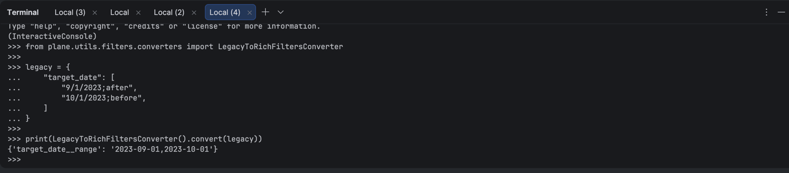
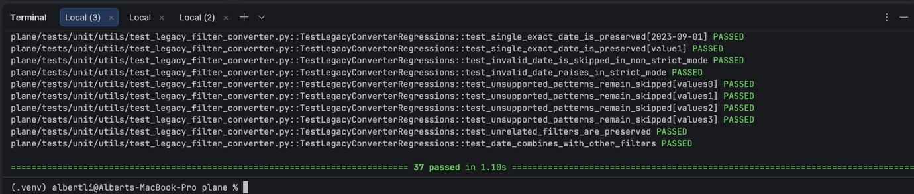

Error reproduced, range is reversed which results in no results in range:

Reproduction code:
docker compose -f docker-compose-local.yml exec api \
 python manage.py shell --settings=plane.settings.local

then in the console,

from plane.utils.filters.converters import LegacyToRichFiltersConverter

legacy = {
"target_date": [
"9/1/2023;after",
"10/1/2023;before",
]
}

print(LegacyToRichFiltersConverter().convert(legacy))

Run tests with :
docker compose -f docker-compose-test.yml run --rm --build api-tests \
 pytest plane/tests/unit/utils/test_legacy_filter_converter.py \
 plane/tests/contract/app/test_legacy_date_filter_conversion.py -vv

Unit and regression tests failed:

Error fixed

Tests passed after fix

