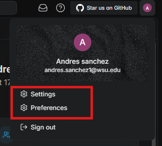
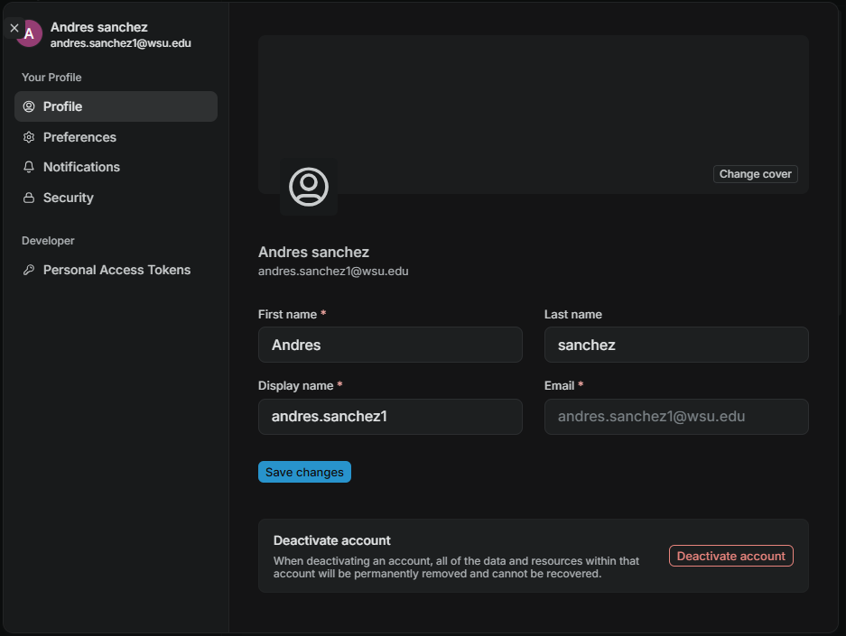
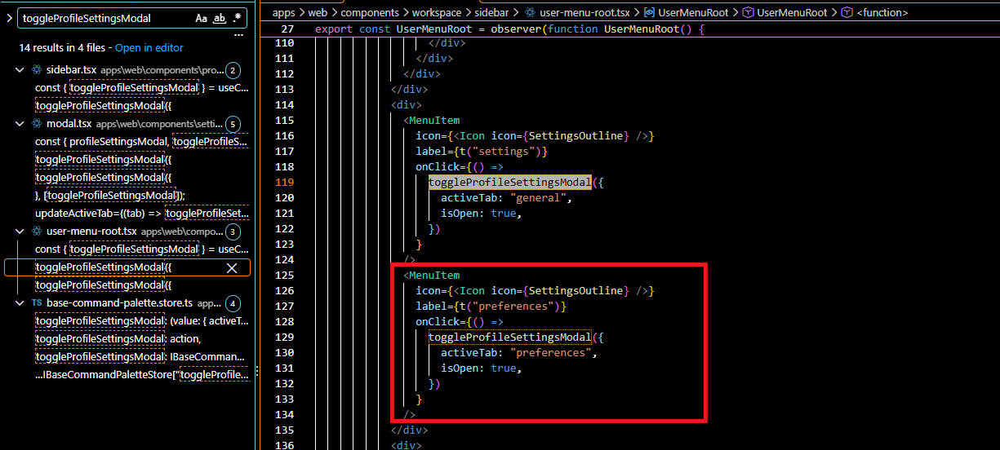
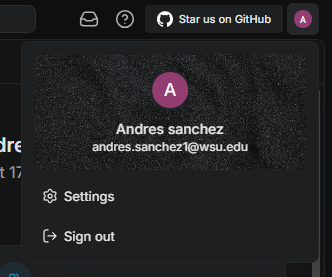

### What is Issue 9793:

A user reported that when opening the user menu you can see two options 'Settings' and 'Preferences'. The issue with this is that upon clicking either 'Settings' or 'Preferences' you are taken to the exact same menu just in a different section. This made people feel confused.

### User Menu

### What happens when clicking 'Settings' or 'Preferences'

### My through process and tools to solving the issue

I was super lucky that the original report named the modal that was in charge of the menu which was named 'toggleProfileSettingsModal' All I had to do was 'CTRL' + 'SHIFT' + 'F" and it allowed me to search for the modal. I eventually found the fix to the issue.

### Two Menu Items one for settings and another for preferences.

What confused me was that the issue was marked as a feature but this seemed more like an improvement at this stage. All I had to do was delete the 'MenuItem' for preferences (In the red box above) and I was done.

### Only settings option remained after fix

### My testing efforts

Once I finished that I went onto testing. I decided to do manual testing as I only deleted code lines I was honestly expecting to add lines. My roomates and I did the following tests.

1. Confirmed the the preferences option was gone after removing the fix.
2. Went into settings and confirmed everything was still functional. This included changing name, displayname, saving changes, switching between themes, and changing password.

No other functionality was affected by removing the menu item as I expected. My roomates and I found no other issues.
